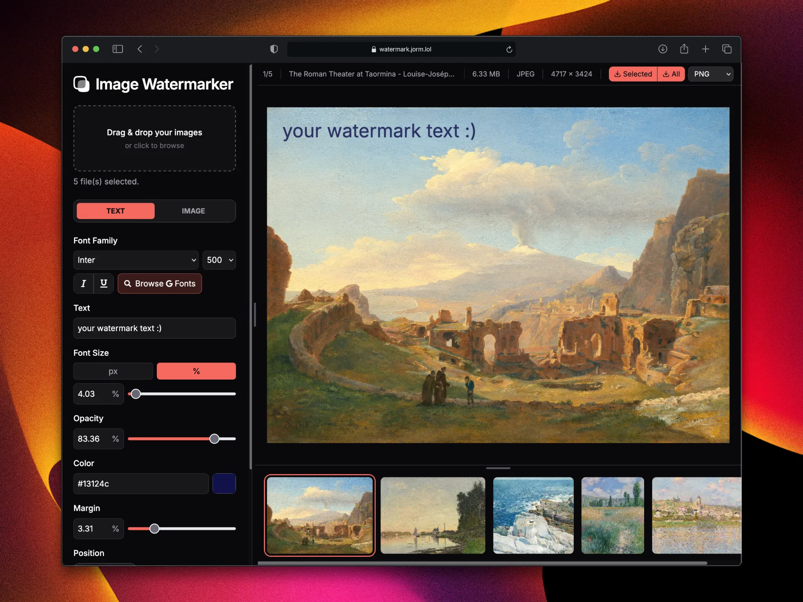
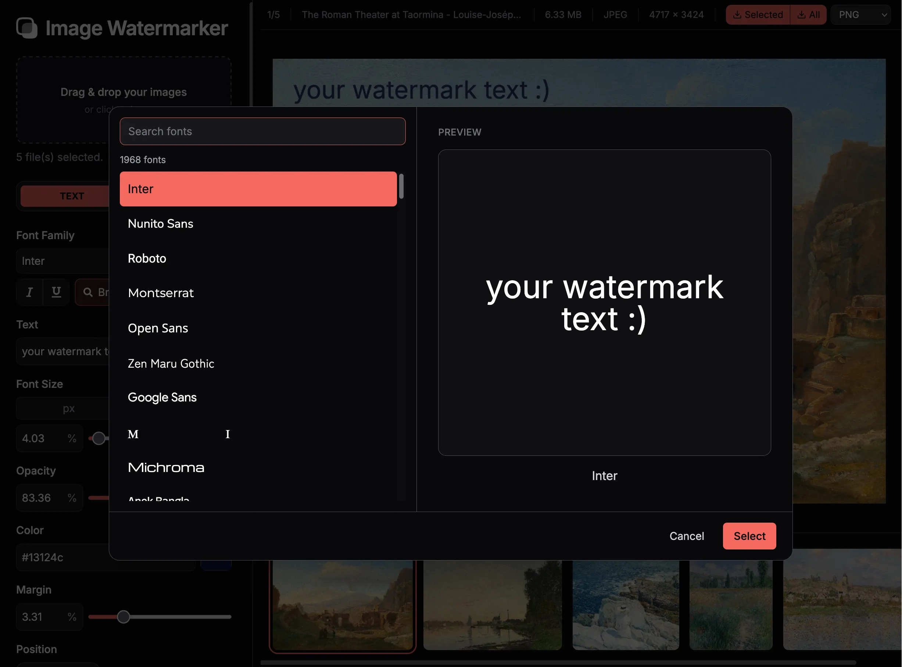
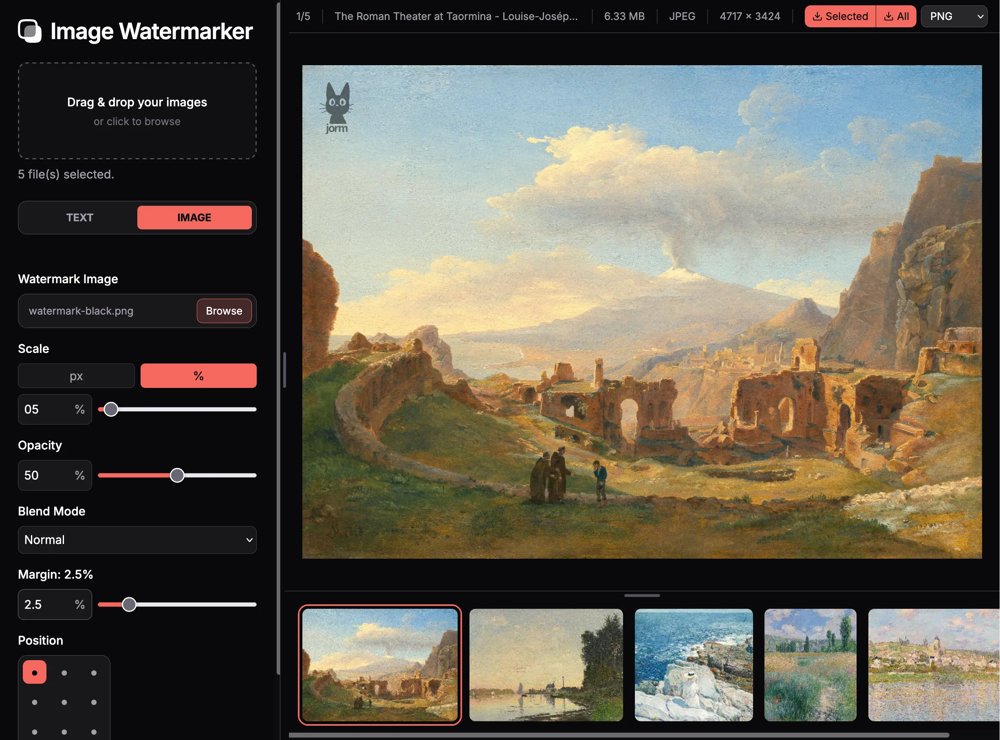

  

<h1 align="center">
  <a href="https://watermark.jorm.lol">Image Watermarker</a>
</h1>

  
  
  

A browser-based tool for batch watermarking images, with flexible text and image watermark customisation. Upload your images, fine-tune your watermarks, preview the results in real time, and export your finished images at full resolution.

## Features

### Batch Image Processing

- **Batch upload** - you can import as many images as you want at once!
- **Thumbnail Strip** - a horizontally scrolling panel where you can switch between uploaded images.
- **Image information** - view details such as the selected filename, file size, dimensions, and file type in the toolbar.
- **Optimised previews** - Thumbnails and preview assets are downsized and cached for stability. The UI stays buttery smooth even with a 10000x10000 image!

### Text Watermarks

- **Google Fonts integration** - choose from almost 2000 Google Fonts using a searchable font picker.
- **Live font previews** - fonts are displayed in their own typefaces, with a preview of your watermark text in each font.
- **Text styling** - custmoise font size, weight, italics, and underline!
- **Text colour** - choose a custom watermark colour.
- **Opacity** - adjust watermark transparency.

  

### Image Watermarks

- **Custom image watermarks** - use an image as your watermark instead of text.
- **Flexible sizing** - adjust the watermark size using pixel values, percentage-based sizing, or scale-based sizing.
- **Opacity** - adjust the transparency of the image watermark.
- **Blend modes** - apply blend modes to change how the watermark interacts visually with the underlying image.

  

### Watermark Customisation

- **Nine-position layout** - position watermarks at the top, centre, or bottom, aligned left, centre, or right.
- **Margin adjustment preview** - margin changes are shown with a black frame over your image that disappears after a second.
- **Real-time preview** - see all of your changes reflected in the image preview as you customise your watermark!

### Export

- **Full-resolution export** - export images at their full original resolution and quality.
- **Multiple output formats** - export as PNG, JPG, or same type as source image.
- **Export options** - you can choose to export all uploaded images, or just the curently selected one.

## How to Use

1. **Upload images** - select or drag and drop the images you want to watermark.
2. **Choose a watermark type** - switch between text and image watermarking.
3. **Customise your watermark** - adjust the font, size, colour, opacity, position, margin, and other available settings (depending on what watermark type you chose).
4. **Preview your changes** - Review the result in the main preview area.
5. **Select your output format** - choose PNG, JPG, or same as your source image.
6. **Export your images** - save the watermarked images at full resolution!

## Tech Stack

- Framework - [Vite 16](https://vite.dev/)
- Styling - [TailwindCSS](https://tailwindcss.com/)
- Font Provider - [Google Fonts](https://fonts.google.com/)
- Deployment & Serverless Functions - [Vercel](https://vercel.com/)

## Privacy

All image processing is performed locally in the browser using the Canvas API.
